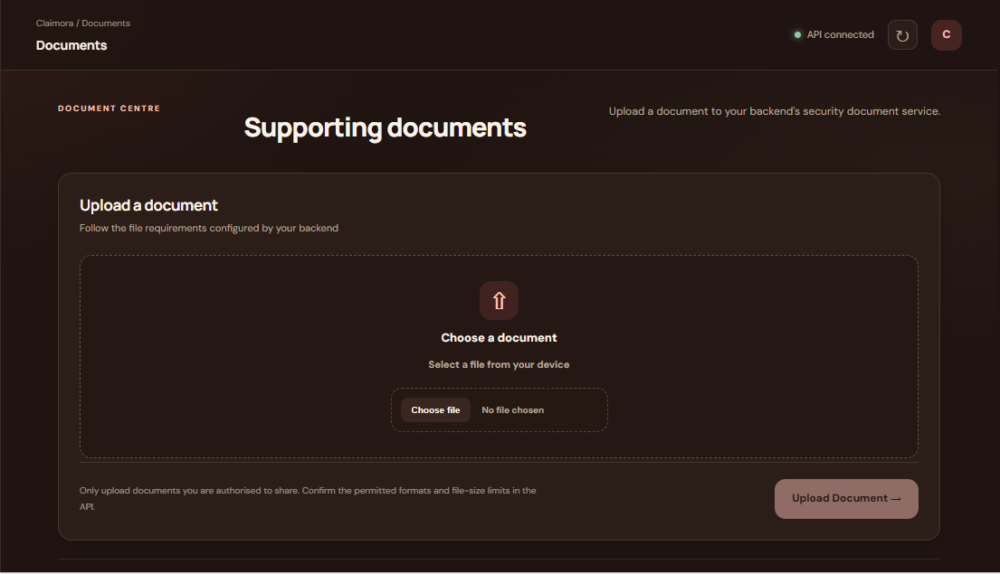
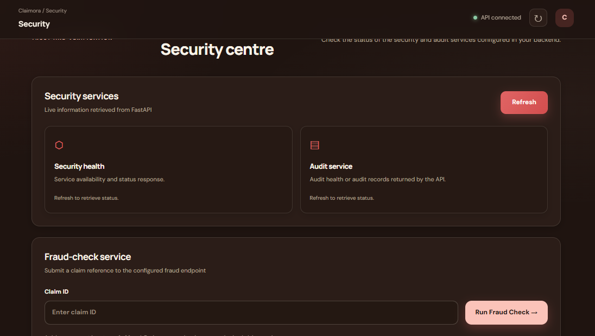

# Claimora AI — Smart Health Insurance Claim Assistance

Claimora AI is an AI-powered health insurance claim assistance platform designed to simplify the insurance claim journey. It helps users understand claim eligibility, organize supporting documents, review claim readiness, explore healthcare providers, and track claim progress through a centralized web application.

## 🏥 Project Overview

Health insurance claim processing can involve multiple steps, including policy eligibility checks, document submission, document verification, fraud risk assessment, and claim status tracking. Claimora AI brings these workflows together in one application to make the process easier to understand and manage.

The platform combines a React frontend with a FastAPI backend and AI-assisted services to support claim-related guidance and workflows.

## Application Screenshots

## Application Screenshots

### Home Page


### Find Care


### New Claim


### Document Upload


### Security

## ✨ Key Features

- **Claim Assistance:** Guides users through the health insurance claim workflow.
- **Claim Readiness:** Helps organize claim information and identify potential missing requirements.
- **Eligibility Guidance:** Supports understanding of policy and claim eligibility information.
- **Document Management:** Provides a workflow for uploading and reviewing claim-related supporting documents.
- **Document Verification:** Supports document verification workflows.
- **AI Assistant:** Provides claim-related guidance using configured AI and retrieval-based services.
- **Fraud Risk Analysis:** Integrates fraud detection functionality to support risk assessment.
- **Claim Tracking:** Helps users follow claim progress through available status information.
- **Hospital and Doctor Discovery:** Supports finding healthcare providers based on available recommendation data.
- **Recommendation Services:** Connects treatment-related requirements with available hospital and doctor information.
- **Security and Audit Features:** Includes backend security-related services and audit functionality.
- **Additional Services:** Includes mail-processing, translation, and data-management API modules.

*Feature availability depends on backend configuration, available data, and connected services. AI-generated guidance and risk assessments do not replace decisions made by insurers or qualified professionals.*

## 🔄 Claim Workflow

The platform is organized around the following claim-assistance workflow:

1. Enter or provide the relevant claim information.
2. Review available claim-readiness and eligibility guidance.
3. Upload the required supporting documents.
4. Run the configured document-verification workflow.
5. Review available fraud-risk assessment results.
6. Process the claim through the configured backend workflow.
7. Follow the claim status using the tracking interface.

Actual processing steps and outcomes depend on the implemented backend logic and insurer requirements. Claimora AI does not guarantee claim approval.

## 🧰 Technology Stack

### Frontend
- React
- Vite
- JavaScript
- HTML and CSS
- Fetch/API integration with the backend

### Backend
- Python
- FastAPI
- Pydantic settings and request validation
- REST API endpoints
- SQLite-compatible database configuration
- AI/RAG service modules
- Document, recommendation, and security services

### AI and Data Processing
- Retrieval-Augmented Generation (RAG) service architecture
- Claim-related knowledge documents
- Fraud detection integration
- Hospital and doctor recommendation services
- Configurable AI and external service integrations

### Development Tools
- Git and GitHub
- Node.js and npm
- Python and pip
- Uvicorn

## 📁 Project Structure

```text
Claimora-AI/
├── README.md
├── package.json
├── package-lock.json
├── backend/
│   ├── app/
│   │   ├── api/
│   │   ├── config.py
│   │   ├── database.py
│   │   ├── models.py
│   │   ├── services.py
│   │   └── main.py
│   ├── rag/
│   │   ├── documents/
│   │   └── rag_service.py
│   ├── recommendation/
│   ├── security/
│   ├── requirements.txt
│   └── train_fraud_model.py
└── claimora-frontend/
    ├── public/
    │   └── images/
    ├── src/
    │   ├── components/
    │   ├── pages/
    │   ├── services/
    │   ├── styles/
    │   ├── App.jsx
    │   └── main.jsx
    ├── index.html
    ├── package.json
    └── vite.config.js
```

## ⚙️ Prerequisites

Install the following before running the project:

- Python 3.10 or a compatible version for the installed dependencies
- Node.js and npm
- Git

External AI, email, or other integrations may require additional credentials and configuration.

## 🚀 Installation and Setup

### 1. Clone the repository

```bash
git clone https://github.com/Snehashree-Hub/Claimora-AI.git
cd Claimora-AI
git checkout clean-main
```

### 2. Set up the backend

Create and activate a Python virtual environment from the repository root.

**Windows PowerShell:**

```powershell
python -m venv .venv
.\.venv\Scripts\Activate.ps1
pip install -r backend\requirements.txt
```

Start the FastAPI backend:

```powershell
uvicorn backend.app.main:app --reload
```

The API will typically be available at:

`http://127.0.0.1:8000`

Interactive API documentation:

`http://127.0.0.1:8000/docs`

Use the actual host and port configured for your environment if they differ.

### 3. Set up the frontend

Open a second terminal and run:

```powershell
cd claimora-frontend
npm install
npm run dev
```

Open the local URL printed by Vite in your terminal, typically:

`http://localhost:5173`

If the frontend uses a configurable API base URL, set it to the address where the backend is running.

## 🔐 Environment Configuration

Some integrations may require environment variables, such as API credentials, database settings, or email service settings.

- Keep secrets in local environment files.
- Never commit `.env` files, API keys, passwords, access tokens, or private credentials.
- Configure environment variables according to the backend settings and the integrations you actually use.
- Replace development-only secret values before deploying to a production environment.
- Do not expose secret keys in frontend code.

Refer to the source configuration and individual integration requirements for the exact environment variable names.

## 🧪 Testing and Verification

After starting the application:

1. Confirm that the backend starts without errors.
2. Open the FastAPI `/docs` page to inspect available API endpoints.
3. Start the frontend and verify that the main page loads.
4. Test claim-assistance and document workflows with non-sensitive sample data.
5. Verify hospital and doctor recommendations against the data available in the environment.
6. Check that API requests reach the correct backend address.

A successful local startup does not by itself establish production readiness or validate every claim-processing workflow.

## 🛡️ Security and Responsible Use

- Use test data when developing or demonstrating the application.
- Do not upload real patient records, identity documents, policy documents, or other sensitive information to an unapproved environment.
- Configure authentication, authorization, CORS, secret management, and file-upload restrictions appropriately before deployment.
- Treat AI-generated explanations and fraud-risk results as decision-support information rather than definitive insurance decisions.
- Obtain claim decisions and coverage confirmation from the relevant insurer.

## 🔮 Future Enhancements

Potential areas for future development include:

- More comprehensive claim status notifications.
- Improved claim-document completeness checks.
- Expanded hospital and doctor recommendation data.
- Additional insurer integrations.
- Enhanced role-based access control.
- Automated testing, monitoring, and production deployment.

## 👩‍💻 Project Information

**Project Name:** Claimora AI  
**Project Type:** AI-powered health insurance claim assistance web application  
**Repository:** [Snehashree-Hub/Claimora-AI](https://github.com/Snehashree-Hub/Claimora-AI)  
**Development Branch:** `clean-main`

## 📄 Disclaimer

Claimora AI is a software project intended to assist with health insurance claim-related information and workflows. It is not an 
